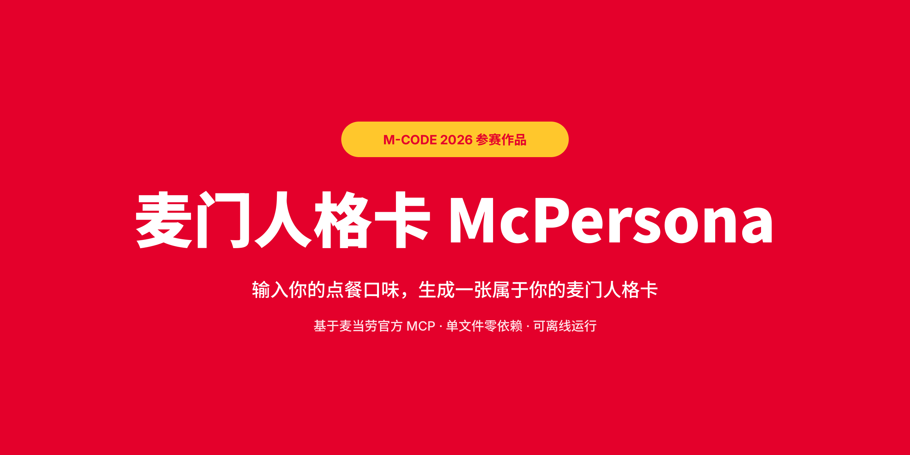
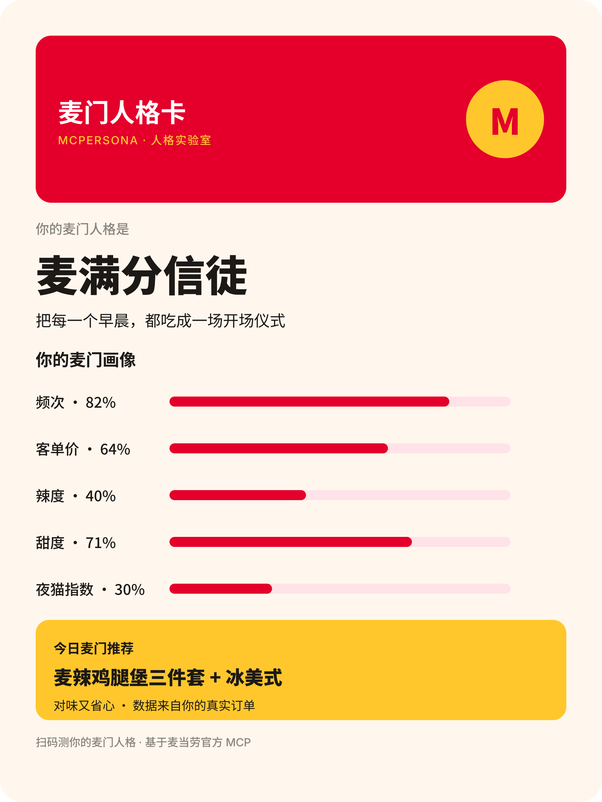

<div align="center">



# 🍔 麦门人格卡 McPersona

**输入你的口味，生成一张属于你的麦门人格卡。**

`M-CODE 2026 参赛作品` · 基于麦当劳官方 MCP · 单文件零依赖 · 可离线运行

  

</div>

---

## ✨ 一句话介绍

把你在麦当劳的点餐口味，变成一张**可以截图发朋友圈的高颜值人格卡** —— 像 MBTI 一样有梗、有画像、有推荐套餐，让你测完想 @ 朋友一起来测。

## 🎬 成品预览



> 上图为示例人格「麦满分信徒」。内置 5 种示例人格可切换演示。

## 🚀 快速开始

**Demo 模式（零配置，立即体验）**

```bash
# 无需任何依赖，直接用浏览器打开
open index.html        # macOS
start index.html       # Windows
```

**完整模式（拉取你的真实订单）**

1. 前往麦当劳 MCP 开放平台登录并激活 Token（见 [MCP_INTEGRATION.md](MCP_INTEGRATION.md)）；
2. 将 Token 注入环境变量 `MCD_MCP_TOKEN`（**切勿提交进仓库**）；
3. 在 WorkBuddy / 任意 MCP 客户端中加载本 Skill，说一句：
   > 「帮我生成我的麦门人格卡」

## 🧩 这个 Skill 能做什么

| 能力 | 说明 |
|---|---|
| 🎴 人格生成 | 基于口味偏好（频次/客单价/辣度/甜度/时段）判定你的麦门人格，人格名有梗、想对号入座 |
| 📊 画像可视化 | 五维人格画像进度条，一眼看懂自己是哪种麦门人 |
| 🍟 套餐推荐 | 按人格匹配「对味又省心」的推荐组合 |
| 📤 一键分享 | 单文件 HTML，截图即卡片，可离线打开、手机流畅播放 |

## 👥 目标用户

- **爱分享的年轻人**：测完想发朋友圈/小红书晒人格卡
- **麦门常客**：想看看自己在麦门世界里的"人设"
- **开发者**：想参考一个「设计驱动型」MCP Skill 的完整样例

## 🏆 关于比赛

本作品参加 [麦当劳 1024 程序员节 · 程序员创意开发大赛（M-CODE）](https://github.com/M-China/mcd-developer-innovation-challenge)。
比赛按 GitHub Star 排名 —— 如果你觉得这个思路有意思，**顺手点个 Star ⭐️ 就是最好的支持**。

## 📄 License

[MIT](LICENSE)
